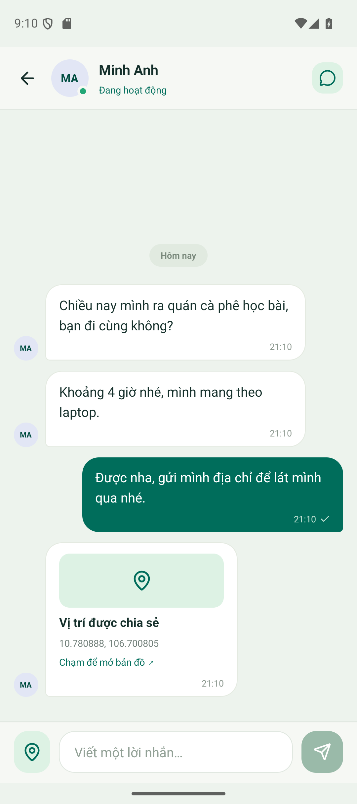

# Chạm — ChatFirebase

Ứng dụng chat 1-1 realtime cho Bài thực hành 5. React Native CLI + TypeScript, React Navigation và Firebase JS SDK.

## Đã triển khai

- Đăng ký có họ tên, email, mật khẩu và xác nhận mật khẩu; kiểm tra đầu vào, báo lỗi tiếng Việt.
- Đăng nhập, lưu phiên bằng AsyncStorage, đăng xuất và đặt lại luồng điều hướng.
- Hoàn tất hồ sơ nếu đăng ký tài khoản thành công nhưng lần lưu hồ sơ bị gián đoạn.
- Danh bạ realtime, loại chính mình, tìm tên/email có hỗ trợ tìm không dấu.
- Online/offline theo từng kết nối thiết bị, `onDisconnect`, cập nhật khi ứng dụng vào nền.
- Chat realtime, căn tin theo người gửi, thời gian và ngày, chặn tin rỗng, tự cuộn xuống tin mới.
- Gửi vị trí hiện tại bằng nút ghim trong Chat; tin vị trí chứa tọa độ, thời gian và liên kết mở bản đồ. Xin quyền khi nhấn gửi; hỗ trợ cả quyền vị trí chính xác và gần đúng.
- Home có avatar, tên, tin cuối, thời gian, bộ lọc chưa đọc; sắp xếp theo tin mới nhất.
- Dấu đã đọc theo từng message ID; chỉ đánh dấu khi màn Chat đang được xem và ứng dụng ở foreground.
- Thông báo trong ứng dụng hiển thị các cuộc trò chuyện có tin chưa đọc.
- Cài đặt tài khoản và tiện ích kiểm tra vị trí dùng `@react-native-community/geolocation`. Tiện ích ở Cài đặt chỉ hiển thị cục bộ; nút gửi vị trí trong Chat gửi tọa độ cho người đang trò chuyện.
- Listener được quản lý tập trung, gỡ khi đổi tài khoản/unmount; snapshot tin nhắn được thay thế để tránh lặp tin.

## Chạy Android

Máy cần Node **24.12+ trong nhánh 24**, hoặc **26+**, JDK và Android SDK. Đã build với JDK 22, SDK/build-tools 37, NDK 27.1.12297006. Android tối thiểu API 24.

Tại thư mục dự án:

```powershell
npm install
npm start
```

Mở terminal thứ hai, bật giả lập hoặc kết nối điện thoại có USB debugging:

```powershell
npm run android
```

Các script tự dùng Node trong `.tools/node` khi Node hệ thống quá cũ. Thư mục công cụ này không được đưa vào Git. Có thể cài riêng mà không đổi Node toàn máy:

```powershell
npm install --prefix .tools/node node@24
```

Nếu cần đặt JDK trên máy hiện tại:

```powershell
$env:JAVA_HOME = 'C:\Program Files\Java\jdk-22'
```

Firebase client config đã có ở `src/services/firebaseConfig.json`. Email/Password và Realtime Database đã bật cho project `chatfirebase-9600c`. Chi tiết schema/luật ở [FIREBASE_SETUP.md](FIREBASE_SETUP.md).

## APK chạy độc lập

Bản đã build: `android/app/build/outputs/apk/release/app-release.apk` (ARM64 + x86_64), có sẵn JavaScript nên không cần Metro. Đây là APK thử nghiệm của bài thực hành, ký bằng debug keystore của bộ khung; chưa cấu hình khóa phát hành lên cửa hàng.

Build lại trong PowerShell:

```powershell
$env:JAVA_HOME = 'C:\Program Files\Java\jdk-22'
$env:Path = "$PWD\.tools\node\node_modules\node\bin;$env:Path"
cd android
.\gradlew.bat assembleRelease assembleReleaseAndroidTest '-PreactNativeArchitectures=arm64-v8a,x86_64' --max-workers=2
```

## Chạy iOS

Cần macOS/Xcode và CocoaPods. Sau khi `npm install`, chạy `bundle install`, rồi `cd ios` và `bundle exec pod install`; quay về gốc để `npm run ios`. Đã cấu hình mô tả quyền vị trí foreground trong Info.plist; chưa build hoặc kiểm thử iOS trên Windows.

## Kiểm tra

```powershell
npm run typecheck
npm run lint
node scripts/run.cjs test --runInBand
```

Kiểm thử Firebase cục bộ (không ghi dữ liệu vào project thật):

```powershell
npm install --prefix .tools/firebase firebase-tools @firebase/rules-unit-testing
npm run test:firebase
```

`firebase.test.json` chọn các cổng localhost riêng và project `demo-chatfirebase`. Script kiểm thử từ chối chạy nếu thiếu cấu hình emulator. Cần Java để chạy Database Emulator.

Đã đạt: TypeScript; ESLint không cảnh báo; 15 kiểm thử Jest; 40 kiểm thử Firebase Emulator; build APK debug/release. Đã kiểm thử gửi nhận hai chiều qua Firebase thật trên hai Android Emulator: Home tăng số chưa đọc 1 → 2 rồi về 0 khi mở chat, danh bạ/tìm kiếm, online/offline, mở lại chat không lặp tin, giữ phiên, đăng xuất và lỗi mật khẩu sai. Phạm vi kiểm thử và demo của bài là Android.

## Ảnh và video nộp bài

**[Xem video hai máy ảo chat với nhau — khoảng 1 phút 14 giây](docs/video/demo-chat-tu-nhien.mp4)**. Hội thoại giữa Minh Anh và Bảo Ngọc gồm tin thường và chia sẻ vị trí; quay đồng thời hai màn hình ở tốc độ gốc.

Ảnh chụp trực tiếp từ app và Firebase Console:

| Nội dung | Ảnh |
| --- | --- |
| Đăng ký | [Xem ảnh](docs/screenshots/01-Dang-ky.png) |
| Home có 2 tin chưa đọc | [Xem ảnh](docs/screenshots/02-Home-chua-doc.png) |
| Danh bạ có trạng thái online | [Xem ảnh](docs/screenshots/03-Danh-ba-online.png) |
| Chat có tin thường và tin vị trí | [Xem ảnh](docs/screenshots/04-Chat-tin-thuong-va-vi-tri.png) |
| Firebase Console — Data tin nhắn | [Xem ảnh](docs/screenshots/05-Firebase-Data-tin-nhan.png) |
| Firebase Console — Data tin vị trí | [Xem ảnh](docs/screenshots/06-Firebase-Data-vi-tri.png) |



Tọa độ demo được mô phỏng trên giả lập. Trên máy chuẩn bị bài nộp, thư mục `submission/TH05-Cham/` còn chứa mã nguồn ZIP, các ảnh/video trên và APK; thư mục này được Git bỏ qua. Các tệp ảnh/video được công khai trong repo nằm tại `docs/`.

`scripts/test-android.cjs` phối hợp hai app thật bằng Android UI Automator. Sau khi build app và APK AndroidTest, bật hai giả lập rồi chạy:

```powershell
npm run test:android
# Quay đồng thời hai màn hình trong 100 giây:
$env:CHAT_ANDROID_RECORD = '1'
npm run test:android
# Hội thoại tự nhiên với Minh Anh/Bảo Ngọc, không thêm mã vào tin nhắn:
$env:CHAT_ANDROID_DEMO = '1'
# Không đặt CHAT_ANDROID_QA_ACCOUNTS khi muốn tạo cặp demo mới.
npm run test:android
```

Script mặc định chọn `emulator-5554` và `emulator-5556`, tạo hai tài khoản QA riêng và ghi dữ liệu demo lên Firebase đã cấu hình. Tài khoản, báo cáo và video gốc nằm trong `.artifacts/android-e2e/<runId>/` (được Git bỏ qua). Không thao tác cùng lúc trên giả lập đang kiểm thử. Có thể dùng lại cặp tài khoản bằng biến `CHAT_ANDROID_QA_ACCOUNTS` trỏ tới `accounts.json` của lần chạy trước; tệp này không đưa vào bài nộp.

Đóng gói sau khi đã chụp hai ảnh Firebase Console vào `submission/TH05-Cham/02-Anh/`:

```powershell
npm install --prefix .tools/video ffmpeg-static ffprobe-static
node scripts/package-submission.cjs <runId>
```

Script yêu cầu báo cáo Android đạt, video đủ 60–120 giây; ghép hai màn hình cùng tốc độ gốc và kiểm tra ZIP không chứa `node_modules`, thư mục `build`, `ios/Pods`, cache hoặc tài khoản QA.

## Kiểm thử thủ công với hai tài khoản

1. Cài APK trên hai thiết bị/giả lập có mạng; đăng ký hai email khác nhau.
2. Kiểm tra nhập lại mật khẩu, mật khẩu dưới 6 ký tự và đăng nhập sai.
3. Danh bạ không chứa chính mình; tìm người kia bằng tên không dấu hoặc email.
4. A nhắn cho B trong khi B ở Home: tin cuối và số chưa đọc của B tăng ngay.
5. B mở Chat: số chưa đọc về 0; trả lời A và kiểm tra cập nhật hai chiều.
6. Đưa B vào nền hoặc ngắt mạng; kiểm tra trạng thái người dùng sau khi Firebase nhận biết ngắt kết nối. Mở lại ứng dụng và kiểm tra online.
7. Ra/vào Chat nhiều lần, đảm bảo tin không xuất hiện lặp. Tin mới trong lúc Chat đang được xem không để lại số chưa đọc.
8. Đăng xuất: quay về Đăng nhập và không quay lại tài khoản cũ bằng nút Back. Đóng/mở app khi chưa đăng xuất để kiểm tra giữ phiên.

Checklist này cũng dùng để tự trình diễn lại trên hai giả lập. iOS chưa được kiểm thử.

## Cấu trúc mã nguồn

- `src/services/`: khởi tạo Firebase, auth, hồ sơ, chat, presence, vị trí và ánh xạ lỗi.
- `src/context/`: trạng thái phiên và các listener dữ liệu của tài khoản.
- `src/navigation/`: auth stack, bottom tabs và Chat.
- `src/screens/`: các màn hình tiếng Việt.
- `src/components/`, `src/theme.ts`: thành phần dùng lại và giao diện.
- `src/utils/chat.ts`: mã chat ổn định, tìm kiếm, sắp xếp và tính tin chưa đọc.
- `database.rules.json`: luật đồng bộ với Firebase Console.
